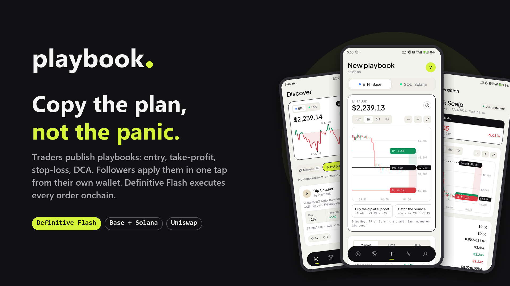

# Playbook



**Copy the plan, not the panic.** Playbook is a social copy-trading app built on **Definitive Flash**. Traders publish
**playbooks**: an entry (market, limit or DCA), a take-profit, a stop-loss and their creator cut. Followers apply a
playbook in one tap from their own self-custodial wallet, as **ETH on Base** or **SOL on Solana**, and **Flash executes
every order onchain**: the entry plus an attached take-profit / stop-loss bracket, so the position is protected the
moment it fills. The creator's cut is charged through Flash's integrator fee on every apply.

Built for ETHGlobal Mumbai: **Definitive: Best Use of Flash Advanced Orders in a Social App** (main track) and the
**Uniswap Foundation** prize (in-app swaps, see [Uniswap integration](#uniswap-integration)).

- Demo video: on X, tagged [@DefinitiveFi](https://x.com/DefinitiveFi)
- Android APK: [playbook.apk](https://srqaygacibwbdbjjhtrr.supabase.co/storage/v1/object/public/releases/playbook.apk)
- API: hosted on Vercel (Expo Router API routes)

## Built on Definitive Flash

Every trade in Playbook goes through the Flash API. The server builds the quote and submits the signed order; the
phone only signs. Flash runs the order and lands the trade onchain, without custody.

### Flash features we use

| Flash feature | How Playbook uses it | Code |
| --- | --- | --- |
| **Market order** | "Buy now" playbooks; optional `maxSlippage` from the playbook | [quote+api.ts#L42](src/app/api/apply/quote+api.ts#L42), [#L60](src/app/api/apply/quote+api.ts#L60) |
| **Limit order** | "Buy the dip" playbooks: entry below the price, with an entry `expireTime` | [quote+api.ts#L50](src/app/api/apply/quote+api.ts#L50) |
| **TWAP / DCA** | DCA playbooks spread the buy over time (`durationSeconds` on quote, `twapBucketCount` slices) | [quote+api.ts#L55](src/app/api/apply/quote+api.ts#L55) |
| **Attached bracket (take-profit + stop-loss)** | Every apply carries `attachedBracket`, so the position is protected from the first fill; optional bracket expiry | [quote+api.ts#L44](src/app/api/apply/quote+api.ts#L44), [#L62](src/app/api/apply/quote+api.ts#L62) |
| **Integrator fee** | The creator's cut on every apply (`flashIntegratorFeeBps`), credited from each fill's `integratorFeeNotional` | [quote+api.ts#L65](src/app/api/apply/quote+api.ts#L65), [positions.ts#L30](src/server/positions.ts#L30) |
| **Quote** | Live price, plan and fees before anything is signed | [quote+api.ts#L67](src/app/api/apply/quote+api.ts#L67) |
| **Submit order, Base (EVM)** | EIP-712 order + Permit2 signatures for the entry and the bracket | [submit+api.ts#L27](src/app/api/apply/submit+api.ts#L27), [#L86](src/app/api/apply/submit+api.ts#L86) |
| **Submit order, Solana (SVM)** | Ed25519 order messages with `svmNonce` / `svmDeadline` for entry and bracket | [submit+api.ts#L60](src/app/api/apply/submit+api.ts#L60) |
| **Solana setup transaction** | One-time token accounts + Flash delegations, compiled on our server without web3.js | [solana.ts#L51](src/server/solana.ts#L51) |
| **Order tracking** | Positions follow fills, average price, the bracket and its exit (placed → bought → take-profit / stop) | [positions.ts#L16](src/server/positions.ts#L16) |
| **Cancel order** | Cancel a waiting entry; the signature is checked against the funder before it reaches Flash | [cancel+api.ts#L20](src/app/api/positions/%5Bid%5D/cancel%2Bapi.ts#L20) |
| **Batch cancel + market sell** | "Close position": cancel the take-profit / stop with one signature, then sell at market | [close.ts#L65](src/server/close.ts#L65), [#L88](src/server/close.ts#L88), [#L149](src/server/close.ts#L149) |
| **Rate limits** | Paced at 4 req/s per endpoint, 429s retried after `RateLimit-Reset`, identical GETs shared | [flash.ts#L25](src/server/flash.ts#L25), [#L56](src/server/flash.ts#L56) |

### The flow

| Step | What happens |
|---|---|
| Create | A trader creates a profile and publishes a playbook in percentages (e.g. buy −2%, TP +5%, SL −3%, 0.5% cut), signed by their wallet |
| Apply | A follower enters an amount. The server turns the percentages into prices at the live price and asks Flash for a quote with `attachedBracket` and `flashIntegratorFeeBps` |
| Sign | **Base:** first time only, USDC + WETH approvals; then two free EIP-712 signatures (entry + protection). **Solana:** first time only, one setup transaction; then two free Ed25519 signatures. The wallet shows each in plain English ([describe.ts#L169](src/wallet/describe.ts#L169), [#L220](src/wallet/describe.ts#L220)) |
| Execute | Flash holds the order, fills the entry, then the bracket sells at take-profit or stop-loss |
| Close early | The follower closes any time: batch cancel of the bracket, then a market sell, all through Flash |
| Earn | Each fill's `integratorFeeNotional` is credited to the playbook's creator |

Everything is live: prices, quotes, fills and fees come from Flash, balances from Base and Solana. There is no
simulated trading mode. Playbooks are percentages, so a playbook can run on either network; each position records its
network.

### The social layer

- **Discover:** Newest, Hot picks (applies, results, votes and freshness) and Following tabs; up / down votes and one-tap follow.
- **Leaderboard:** playbooks ranked by realized return, win rate, applies and volume.
- **Creators:** search, creator pages, and wallet-signed profiles that nobody can impersonate.
- **Positions:** a timeline per position, results, transaction links, and close early.

> The repo includes `npm run seed:demo`, which fills an empty database with clearly tagged demo creators and trade
> history for testing (`npm run seed:demo -- --remove` deletes all of it). Demo rows are not real users.

## Stack

- Expo SDK 58 / React Native 0.88, Expo Router (screens in `src/app`, server routes in `src/app/api`)
- Built-in self-custodial wallet: create or import (12/24-word phrase or private key), keys encrypted on the phone
  with SecureStore, fingerprint/PIN unlock, every signature confirmed in an in-app sheet
- One phrase, two accounts (like MetaMask): Ethereum at `m/44'/60'/0'/0/0` (viem) and Solana at `m/44'/501'/0'/0'`
  (SLIP-0010 ed25519 via noble, same address as Phantom/Solflare). Private-key imports are Ethereum-only
- Solana without a web3 library: the server compiles the one-time setup transaction (`src/server/solana.ts`), the app
  decodes it again to show what it does, signs it locally, and the server broadcasts it
- Flash API called only from the server routes (`src/server/flash.ts`); the API key never ships in the app
- Supabase Postgres via `postgres` (`src/server/db.ts`). Tables (`traders`, `templates`, `applications`, `quotes`)
  are in `public`, defined in `supabase/migrations`. Row Level Security is on and the publishable key has no access,
  so only the server routes (connecting with `DATABASE_URL`) can read or write them
- Uniswap API for in-app swaps on Base (`src/server/uniswap.ts`), see below

## Setup

1. `npm install`
2. `cp .env.example .env` and fill in:
   - `DATABASE_URL`: Supabase → Connect → **Session pooler** connection string (IPv4). URL-encode special
     characters in the password (`@` → `%40`).
   - `FLASH_API_KEY`: your key from app.definitive.fi (More → Flash → Create Flash Key). Empty = the public dev key from the Flash docs (fees are not collected).
   - `EXPO_PUBLIC_BASE_RPC_URL` (optional): your own Base RPC. Empty = the public `mainnet.base.org` endpoint.
   - `SOLANA_RPC_URL` / `EXPO_PUBLIC_SOLANA_RPC_URL` (optional): Solana RPC for the server and the app. Empty = the
     public `api.mainnet-beta.solana.com` endpoint (rate-limited; use a provider such as Helius for real traffic).
3. `npm run db:push` applies `supabase/migrations` with the Supabase CLI (tables plus the starter playbooks).
   Only migrations the database hasn't recorded yet run. Add `-- --dry-run` to preview. For a schema change,
   add a new file with `npx supabase migration new <name>` and push again.
4. Android toolchain (Windows): set `ANDROID_HOME=%LOCALAPPDATA%\Android\Sdk` and add `%ANDROID_HOME%\platform-tools` to `PATH`.

## Run

The wallet uses native modules (SecureStore, biometrics, quick-crypto), so the app needs a **development build** (Expo Go will not work):

```bash
npx expo run:android
```

After the first build, start the dev server (it also serves the API routes) with:

```bash
npx expo start
```

The phone must reach your laptop over the same Wi-Fi network.

## Uniswap integration

Playbook swaps on **Base** through the **Uniswap API** (`trade-api.gateway.uniswap.org/v1`), which routes through
Uniswap v2, v3 and v4 pools. Users get:

- **Wallet → Swap:** ETH, USDC and WETH. Enter what you pay (exact input) or what you want to get (exact output).
- **Get USDC with Uniswap:** when applying a playbook fails for lack of USDC, one tap opens a swap for exactly the
  missing amount, paid in ETH.

How it works (`check_approval` → `quote` → sign `permitData` → `swap` → send):

| Step | Code |
| --- | --- |
| API client (server only, key stays off the phone, 6 req/s limit) | [src/server/uniswap.ts#L31](src/server/uniswap.ts#L31) |
| `/quote` with v2 / v3 / v4 routing and 0.5% slippage | [src/server/uniswap.ts#L84](src/server/uniswap.ts#L84) |
| `/check_approval` for Permit2 (ERC-20 input only) | [src/server/uniswap.ts#L107](src/server/uniswap.ts#L107) |
| `/swap` turns the quote and Permit2 signature into a transaction | [src/server/uniswap.ts#L137](src/server/uniswap.ts#L137) |
| App routes | [quote+api.ts](src/app/api/uniswap/quote%2Bapi.ts), [swap+api.ts](src/app/api/uniswap/swap%2Bapi.ts) |
| Wallet flow: approval, Permit2 signature, router check, send | [src/lib/swapFlow.ts#L34](src/lib/swapFlow.ts#L34) |
| `permitData` → standard EIP-712 JSON for the signer | [src/lib/swapFlow.ts#L22](src/lib/swapFlow.ts#L22) |
| Transaction must call a Universal Router on Base | [src/lib/swapFlow.ts#L60](src/lib/swapFlow.ts#L60), [src/lib/constants.ts#L16](src/lib/constants.ts#L16) |
| Confirmation sheet: "Swap X for Y" and the Permit2 permit, decoded on the phone | [src/wallet/describe.ts#L69](src/wallet/describe.ts#L69), [src/wallet/describe.ts#L174](src/wallet/describe.ts#L174) |
| Swap screen | [src/app/wallet/swap.tsx](src/app/wallet/swap.tsx) |
| Apply flow: short of USDC → swap for the missing amount | [src/lib/applyFlow.ts#L38](src/lib/applyFlow.ts#L38), [src/components/ApplySheet.tsx#L117](src/components/ApplySheet.tsx#L117) |

Setup: create a free key at developers.uniswap.org/dashboard and set `UNISWAP_API_KEY` in `.env` (local) and in
Vercel → Environment Variables (hosted API). Developer feedback for the Uniswap team is in [FEEDBACK.md](FEEDBACK.md).

## Share with friends (Android)

The API runs on Vercel and the app is a signed APK your friends install from a link. Both fit the free tiers.

**1. Host the API on Vercel (once).** `vercel.json` builds only the server (`expo export -p web --no-ssg`), and
`api/index.ts` serves it. There is no website.

```bash
npx vercel login
npx vercel deploy --prod
```

In the Vercel dashboard, open Project → Settings → Environment Variables and set `DATABASE_URL` (Supabase's
**Transaction pooler**, port 6543, for serverless), `FLASH_API_KEY` and `SOLANA_RPC_URL`, then deploy again. Put the
production URL in `.env` as `PLAYBOOK_API_ORIGIN`. Deploy again after any change under `src/server` or `src/app/api`.

**2. Release an APK.**

```bash
npm run release -- --notes "What changed"
```

The script checks that the API answers, bumps the version, builds a signed arm64 APK, and uploads it to Supabase
Storage (public bucket `releases`) with a `latest.json`. It prints the link to share (`.../releases/playbook.apk`).
Installed copies show **Update available** on Discover and download the new APK when tapped. The first run creates the
signing key at `~/.playbook/playbook-release.jks` and saves its password in `.env`. Back up both: every update must be
signed with the same key. If the upload fails after a build, run `npm run release -- --upload-only`.

A release APK is signed with a different key than a development build, so uninstall the dev build first. That deletes
the wallet on the phone, so write down its secret phrase first (Wallet → Security) and import it afterwards.

## Demo tips

- Use **Quick Scalp** (market buy, ±0.3%) so the fill and the take-profit happen on camera.
- Create a wallet in the app (or import a dedicated trading wallet), then fund it on Base with ~$30 USDC and a little ETH
  for the two one-time approvals (Wallet → Receive).
- Fills link to Basescan from the Positions tab.

## Checks

```bash
npx tsc --noEmit
npx expo lint
npx expo-doctor
```
